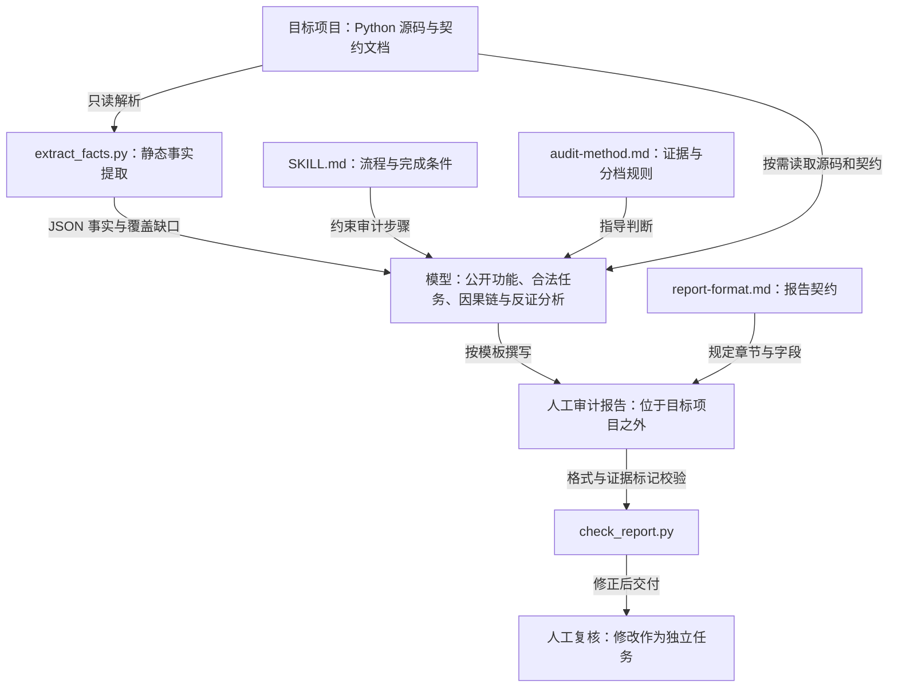

# Gatecreep

面向 Python Agent、CLI 和 Skill 项目的只读门禁审计 Skill，用于识别合法任务被阻断、过严校验、硬编码限制、静默截断等问题。

## 项目架构

Gatecreep 由 Skill 指令、两个独立的 Python 命令行脚本和审计参考文档组成。流程由使用 Skill 的模型执行，脚本不自动编排审计或生成语义结论。Python 脚本仅依赖标准库。



[交互式架构图](docs/architecture.html) · [架构图源文件](docs/architecture.json)。下载 HTML 后用浏览器打开，可切换主题、缩放和查看关系。

### 模块职责

| 模块 | 职责 |
|---|---|
| [Skill 入口](gatecreep/SKILL.md) | 定义输入、只读边界、执行顺序和完成条件 |
| [事实提取器](gatecreep/scripts/extract_facts.py) | 遍历目标目录，使用文本与 AST 解析提取能力、门禁和调用事实；关联静态调用与可达门禁 |
| [审计方法](gatecreep/references/audit-method.md) | 指导模型建立公开功能清单、合法任务、失败因果链、证据分档与反证检查 |
| [报告模板](gatecreep/references/report-format.md) | 规定报告章节、主要发现字段和事实与建议边界 |
| [报告检查器](gatecreep/scripts/check_report.py) | 检查必要章节、主要发现分档、字段和因果链标记，以及覆盖缺口下的错误完整性声明 |
| [回归检查](gatecreep/tests/check_extract_facts.py) | 验证事实提取行为、CLI 扫描、严格 JSON 解析和 ID 唯一性 |
| [OpenSpec 规格](openspec/specs/python-fact-extraction/spec.md) | 保存事实提取的行为契约；变更历史位于 `openspec/changes/archive/` |

### 数据与执行边界

事实提取输出采用 `schema_version: 2`，包含 `capabilities`、`gates`、`flows`、`documents` 和 `coverage`。调用关系区分 `confirmed` 与 `inferred`；动态路径和解析缺口必须保留在分析中。脚本事实本身不构成“过度门禁”结论。

模型结合实现与契约，将问题分为契约冲突、疑似过度门禁、合理门禁、非门禁问题或证据不足。报告检查器只检查结构与部分证据边界，不能证明结论正确，也不替代人工复核。

审计不导入或执行目标代码，不在目标项目内写入报告、缓存、配置或修复。报告完成后停止，修改目标项目属于用户确认后的独立任务。过度设计分析默认关闭，仅在明确请求时启用。

## 使用方式

### 加载 Skill

将本仓库的 `gatecreep/` 目录完整放入所用 AI 工具支持的 Skill 目录，保留其中的 `SKILL.md`、`references/` 和 `scripts/`。按该工具的方式加载或选择 `gatecreep`；也可以在对话中指定本地 `gatecreep/SKILL.md`，要求模型遵循它执行审计。

运行环境需要能够读取目标项目文件，并提供 Python 3.10 或更新版本来运行辅助脚本。事实提取和报告检查由模型按 Skill 流程调用，用户通过对话提出审计需求即可。

### 发起审计

提供目标项目路径即可开始，例如：

```text
请使用 gatecreep Skill 审计 E:/projects/my-agent，检查是否存在阻断合法任务的过度门禁。
将报告保存到 E:/reports/my-agent-gatecreep.md。
```

可以限定功能或文件范围：

```text
请使用 gatecreep Skill 审计 E:/projects/my-cli，重点检查批量导入功能，
包括输入校验、数量限制、单项失败处理和结果完整性。
将报告保存到 E:/reports/my-cli-gatecreep.md。
```

| 输入 | 说明 |
|---|---|
| 目标项目路径 | 必填，指向要审计的 Python Agent、CLI 或 Skill 项目 |
| 功能或文件范围 | 可选，用于限定本次审计范围 |
| 报告输出位置 | 可选，必须位于目标项目之外 |
| 过度设计分析 | 默认关闭；需要时明确要求“同时分析过度设计” |

### 查看结果与后续处理

Skill 会先提取静态事实，结合项目文档与实现建立公开功能清单，再围绕合法任务分析门禁及其影响，最终交付 Markdown 审计报告。报告包含主要发现、源码证据和因果链、合理门禁、待人工复核项，以及覆盖缺口和不确定性。

审计只读取目标项目，不执行目标代码或自动修改项目。审阅报告并确认具体发现后，可以另行要求模型实施修改。已有报告也可以交给此 Skill 复核：

```text
请使用 gatecreep Skill，结合 E:/projects/my-agent 的源码，
复核 E:/reports/my-agent-gatecreep.md 中的发现，检查证据、因果链和反证是否充分。
```

