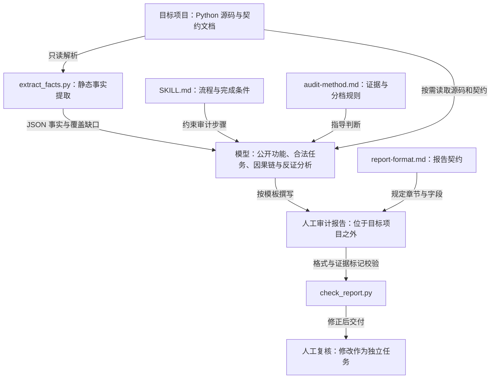

# Gatecreep

面向 Python Agent、CLI 和 Skill 项目的只读门禁审计 Skill，用于识别合法任务被阻断、过严校验、硬编码限制、静默截断等问题。

## 项目架构

Gatecreep 由 Skill 指令、两个独立的 Python 命令行脚本和审计参考文档组成。流程由使用 Skill 的模型执行，脚本不自动编排审计或生成语义结论。Python 脚本仅依赖标准库。



[交互式架构图](docs/architecture.html) · [架构图源文件](docs/architecture.json)。下载 HTML 后用浏览器打开，可切换主题、缩放和查看关系。

### 模块职责

| 模块 | 职责 |
|---|---|
| [Skill 入口](gatecreep/SKILL.md) | 定义输入、只读边界、执行顺序和完成条件 |
| [事实提取器](gatecreep/scripts/extract_facts.py) | 遍历目标目录，使用文本与 AST 解析提取能力、门禁和调用事实；关联静态调用与可达门禁 |
| [审计方法](gatecreep/references/audit-method.md) | 指导模型建立公开功能清单、合法任务、失败因果链、证据分档与反证检查 |
| [报告模板](gatecreep/references/report-format.md) | 规定报告章节、主要发现字段和事实与建议边界 |
| [报告检查器](gatecreep/scripts/check_report.py) | 检查必要章节、主要发现分档、字段和因果链标记，以及覆盖缺口下的错误完整性声明 |
| [回归检查](gatecreep/tests/check_extract_facts.py) | 验证事实提取行为、CLI 扫描、严格 JSON 解析和 ID 唯一性 |
| [OpenSpec 规格](openspec/specs/python-fact-extraction/spec.md) | 保存事实提取的行为契约；变更历史位于 `openspec/changes/archive/` |

### 数据与执行边界

事实提取输出采用 `schema_version: 2`，包含 `capabilities`、`gates`、`flows`、`documents` 和 `coverage`。调用关系区分 `confirmed` 与 `inferred`；动态路径和解析缺口必须保留在分析中。脚本事实本身不构成“过度门禁”结论。

模型结合实现与契约，将问题分为契约冲突、疑似过度门禁、合理门禁、非门禁问题或证据不足。报告检查器只检查结构与部分证据边界，不能证明结论正确，也不替代人工复核。

审计不导入或执行目标代码，不在目标项目内写入报告、缓存、配置或修复。报告完成后停止，修改目标项目属于用户确认后的独立任务。过度设计分析默认关闭，仅在明确请求时启用。

## 使用方式

在支持 Skill 的工具中加载 `gatecreep/SKILL.md`，提供目标项目路径及可选审计范围。模型按 Skill 流程完成分析；以下命令用于其中的事实提取和报告检查：

```bash
python -I gatecreep/scripts/extract_facts.py <target-project>
python -I gatecreep/scripts/check_report.py <report.md>
```

保存事实输出并记录非零退出或覆盖缺口；报告必须位于目标项目之外。

运行事实提取回归检查：

```bash
python -I gatecreep/tests/check_extract_facts.py
```
