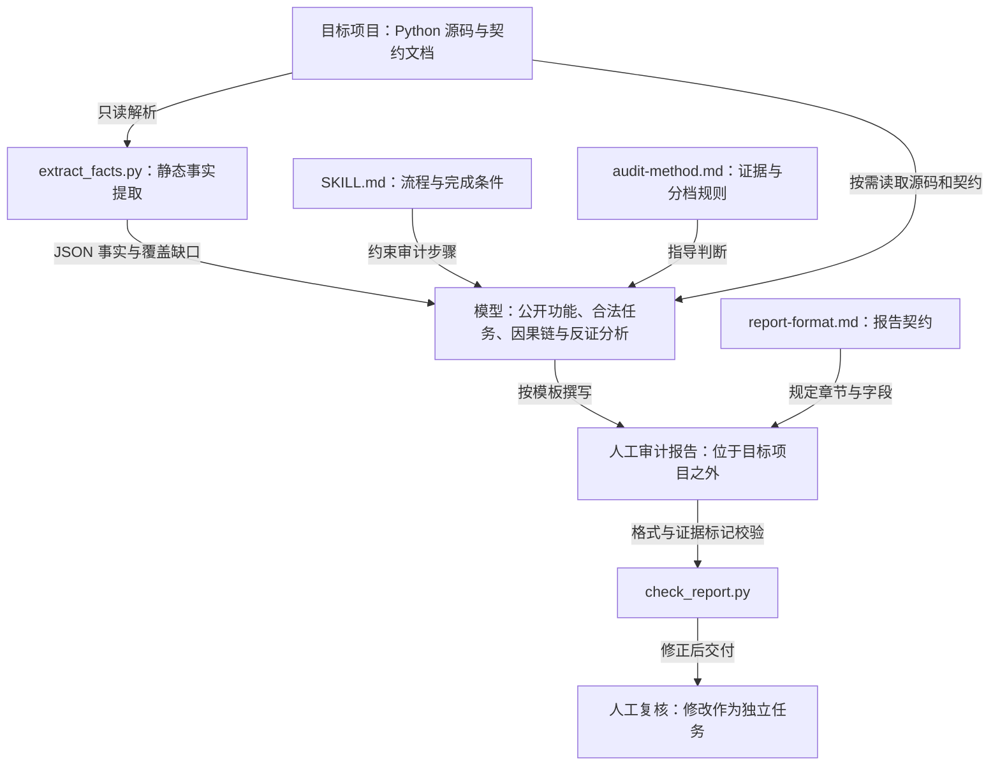

# Gatecreep

**审计 Python Agent、CLI 和 Skill 项目中阻断合法任务的校验、硬编码限制与静默截断。**

Read-only gate auditing for Python AI agents, CLI tools and skills.

Gatecreep 是由模型执行的审计 Skill：标准库脚本提取静态事实，模型结合项目契约判断影响，报告给出源码证据、因果链、反证与覆盖缺口。

## 一条真实发现

Gatecreep 自审发现：**同一条因果链写成一行能通过，按方法文档换行却被报告检查器拒绝。**

| 合法报告的写法 | 历史版本结果 | 当前版本结果 |
|---|---|---|
| 单行因果链，带 `[静态事实]` | 通过 | 通过 |
| 多行箭头结构，标记放在续行 | 拒绝：“因果链必须标注…” | 通过 |

历史检查器只读取 `- 因果链：` 的首行，遗漏了续行上的证据标记。修复扩大了字段读取范围，同时保留无标记时的拒绝。

**[查看真实示例报告](docs/example-report.md)**：目标是历史提交 `97bb54c` 中的因果链校验路径，包含契约、源码位置、最小对照和反证。这是限定范围自审；该问题已在当前代码修复，不能代表整个项目的审计结论。

## 可以帮你检查什么

| 任务失败线索 | 报告需要回答 |
|---|---|
| 合法输入被拒绝 | 哪条校验与已声明的输入范围冲突？ |
| 单项失败终止整批任务 | 失败是否可以恢复，处理范围是否有依据？ |
| 硬编码数量或资源限制 | 限制保护什么，是否有配置或恢复路径？ |
| 结果被静默截断 | 哪条路径丢了结果，是否仍被当作完整成功？ |

这些是审计线索，不能直接当作缺陷。认证、授权、平台约束等合理门禁会保留并说明依据。

## 快速开始

需要 Python 3.10+，以及能读取本地项目、遵循 Skill 并运行辅助脚本的 AI 工具。

```bash
git clone https://github.com/sinyookkkk/Gatecreep.git
```

在所用 AI 工具的对话里指定克隆后的 `gatecreep/SKILL.md`，例如：

```text
请遵循 /path/to/Gatecreep/gatecreep/SKILL.md，
审计 /path/to/my-agent，重点检查输入校验、批量失败处理和结果完整性。
将报告保存到目标项目之外的 /path/to/reports/my-agent.md。
```

将示例路径替换为本机绝对路径。也可以将整个 `gatecreep/` 放入工具支持的 Skill 目录后按名称加载，保留 references/ 和 scripts/。

审计结合 Python 实现与项目契约；系统指令、模型自身行为和运行权限导致的拒绝，无法仅凭这些代码解释。跨语言实现和动态路径会作为覆盖边界披露。报告只读，修复作为独立任务进行。

## 详细使用方式

### 加载与运行环境

将本仓库的 `gatecreep/` 目录完整放入所用 AI 工具支持的 Skill 目录，保留其中的 `SKILL.md`、`references/` 和 `scripts/`。按该工具的方式加载或选择 `gatecreep`；也可以在对话中指定本地 `gatecreep/SKILL.md`，要求模型遵循它执行审计。

运行环境需要能够读取目标项目文件，并提供 Python 3.10 或更新版本来运行辅助脚本。事实提取和报告检查由模型按 Skill 流程调用，用户通过对话提出审计需求即可。

### 发起审计

提供目标项目路径即可开始，例如：

```text
请使用 gatecreep Skill 审计 E:/projects/my-agent，检查是否存在阻断合法任务的过度门禁。
将报告保存到 E:/reports/my-agent-gatecreep.md。
```

可以限定功能或文件范围：

```text
请使用 gatecreep Skill 审计 E:/projects/my-cli，重点检查批量导入功能，
包括输入校验、数量限制、单项失败处理和结果完整性。
将报告保存到 E:/reports/my-cli-gatecreep.md。
```

| 输入 | 说明 |
|---|---|
| 目标项目路径 | 必填，指向要审计的 Python Agent、CLI 或 Skill 项目 |
| 功能或文件范围 | 可选，用于限定本次审计范围 |
| 报告输出位置 | 可选，必须位于目标项目之外 |
| 过度设计分析 | 默认关闭；需要时明确要求“同时分析过度设计” |

### 查看结果与后续处理

Skill 会先提取静态事实，结合项目文档与实现建立公开功能清单，再围绕合法任务分析门禁及其影响，最终交付 Markdown 审计报告。报告包含主要发现、源码证据和因果链、合理门禁、待人工复核项，以及覆盖缺口和不确定性。

审计只读取目标项目，不执行目标代码或自动修改项目。审阅报告并确认具体发现后，可以另行要求模型实施修改。已有报告也可以交给此 Skill 复核：

```text
请使用 gatecreep Skill，结合 E:/projects/my-agent 的源码，
复核 E:/reports/my-agent-gatecreep.md 中的发现，检查证据、因果链和反证是否充分。
```


## 项目架构

Gatecreep 由 Skill 指令、两个独立的 Python 命令行脚本和审计参考文档组成。流程由使用 Skill 的模型执行，脚本不自动编排审计或生成语义结论。Python 脚本仅依赖标准库。



[交互式架构图](docs/architecture.html) · [架构图源文件](docs/architecture.json)。下载 HTML 后用浏览器打开，可切换主题、缩放和查看关系。

### 模块职责

| 模块 | 职责 |
|---|---|
| [Skill 入口](gatecreep/SKILL.md) | 定义输入、只读边界、执行顺序和完成条件 |
| [事实提取器](gatecreep/scripts/extract_facts.py) | 遍历目标目录，使用文本与 AST 解析提取能力、门禁和调用事实；关联静态调用与可达门禁 |
| [审计方法](gatecreep/references/audit-method.md) | 指导模型建立公开功能清单、合法任务、失败因果链、证据分档与反证检查 |
| [报告模板](gatecreep/references/report-format.md) | 规定报告章节、主要发现字段和事实与建议边界 |
| [报告检查器](gatecreep/scripts/check_report.py) | 检查必要章节、主要发现分档、字段和因果链标记，以及覆盖缺口下的错误完整性声明 |
| [回归检查](gatecreep/tests/check_extract_facts.py) | 验证事实提取行为、CLI 扫描、严格 JSON 解析和 ID 唯一性 |
| [OpenSpec 规格](openspec/specs/python-fact-extraction/spec.md) | 保存事实提取的行为契约；变更历史位于 `openspec/changes/archive/` |

### 数据与执行边界

事实提取输出采用 `schema_version: 3`，包含 `capabilities`、`gates`、`flows`、`documents` 和 `coverage`。调用关系区分 `confirmed` 与 `inferred`；动态路径和解析缺口必须保留在分析中。脚本事实本身不构成“过度门禁”结论。

argparse 提取支持直接赋值的 `ArgumentParser`（包括导入别名）及直接声明的参数，并保留子命令参数；跨函数传递、动态构造等写法不保证完整解析。空 `coverage` 不代表完整覆盖，仍需结合源码复核。

扫描会在进入虚拟环境（含 `pyvenv.cfg`）和 `.uv-cache` 等缓存前剪枝，并在 `coverage` 记录排除路径与原因。测试事实保留，使用 `source_role: test` 标记；其他路径为 `unknown`，不能据此认定是产品代码。

MCP 提取支持静态 `mcp.types.Tool` 声明、导入别名和直接赋值的字面量输入 Schema。工具声明与 `call_tool` / `list_tools` 分派、列举函数分开记录；无法确认的逐工具实现映射保留为覆盖缺口，不自动关联共享分派器的所有门禁。

JSON 使用 ASCII 转义，在目标目录外完成临时序列化后分块输出；序列化失败不输出 JSON 前缀，写出或刷新失败仍可能留下部分数据。非零退出时必须丢弃 stdout 并保留 stderr。事实与调用关联仍占用内存，大项目应限定范围；输出不默认截断，也不保证任意规模都能完成。

模型结合实现与契约，将问题分为契约冲突、疑似过度门禁、合理门禁、非门禁问题或证据不足。报告检查器只检查结构与部分证据边界，不能证明结论正确，也不替代人工复核。

审计不导入或执行目标代码，不在目标项目内写入报告、缓存、配置或修复。报告完成后停止，修改目标项目属于用户确认后的独立任务。过度设计分析默认关闭，仅在明确请求时启用。


### 源码快照和证据核验

版本 3 事实新增 manifest 与 snapshot_id，摘要针对实际读取字节，支持非 Git 和未提交修改。版本 2 事实需重新提取，不能当作已绑定快照。manifest 记录读取、解析失败、跳过或读取失败；排除目录只记录剪枝目录，不枚举后代。

新版报告附 evidence.json；交付前运行：
`python -I gatecreep/scripts/check_report.py <report> --facts <facts.json> --evidence <evidence.json> --target <target>`。
证据格式见报告模板。旧命令仍可检查格式，但不核验引用。引用通过不代表语义、运行行为或扫描完整性已获证明。文件变化须重新分析，历史失败不能自动归到当前代码。

[工具恢复案例评估](docs/tool-recovery-evaluation.md) 使用合成源码和记录，不代表真实交易流程验证。新增回归命令：`python -I gatecreep/tests/check_evidence.py`。

### 四阶段功能发现

脚本扫描 → AI 沿线索阅读仓库总结功能 → AI 补查盲区 → 核对合并。每一步保存 JSON，分别为 01-scan.json、02-features.json、03-supplement.json、04-reconciliation.json，关联现有 evidence.json。脚本文件复用版本 3，其他三个采用 discovery_version 1。

[字段契约](gatecreep/references/discovery-format.md) · [完整示例](docs/discovery-example/report.md)。所有输出放在目标之外，使用同一快照。每个入口候选都有处置记录，动态或跨语言缺口明确保留，不把函数数量当功能数量，也不把候选处置完整当功能覆盖完整。

检查命令：
```bash
python -I gatecreep/scripts/check_discovery.py --scan <01-scan.json> --summary <02-features.json> --supplement <03-supplement.json> --final <04-reconciliation.json> --evidence <evidence.json> --target <目标> --report <报告>
python -I gatecreep/tests/check_discovery.py
```
模型负责功能语义、合并拆分和证据充分性；程序检查结构、关联、候选处置及源码引用。报告交付前再验证快照，变化时重分析。旧格式检查仍可使用，但不代表新四阶段流程完成。
